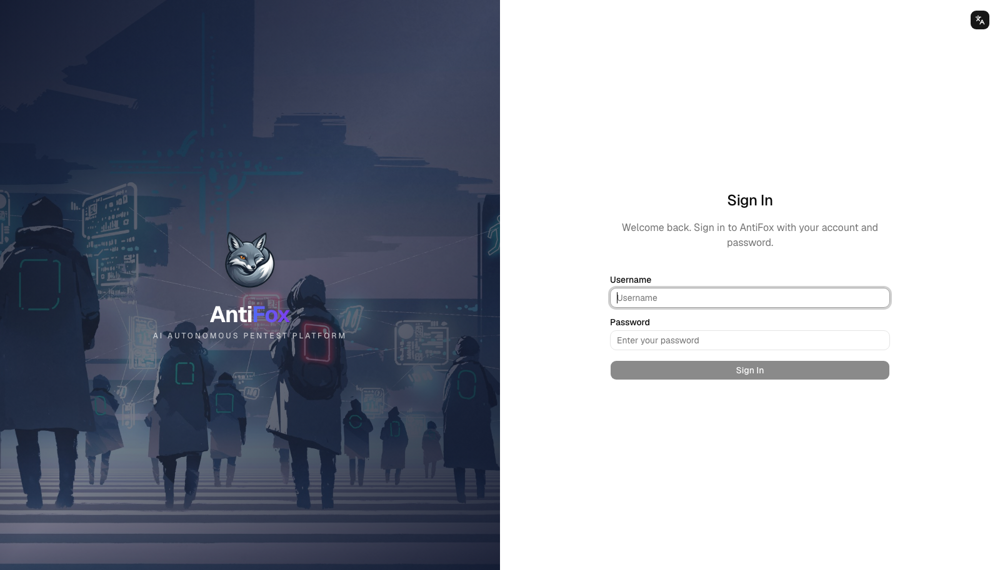
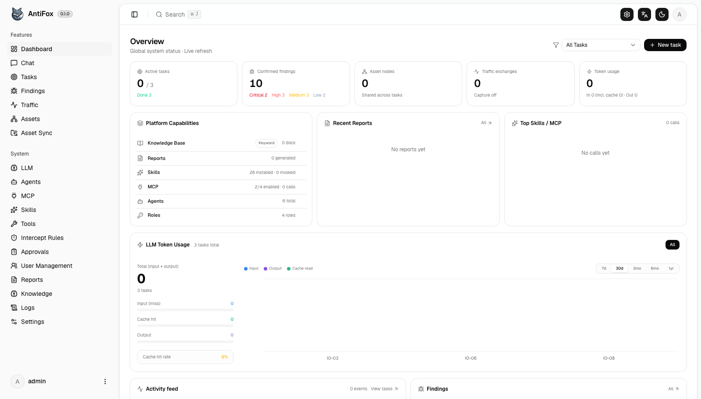
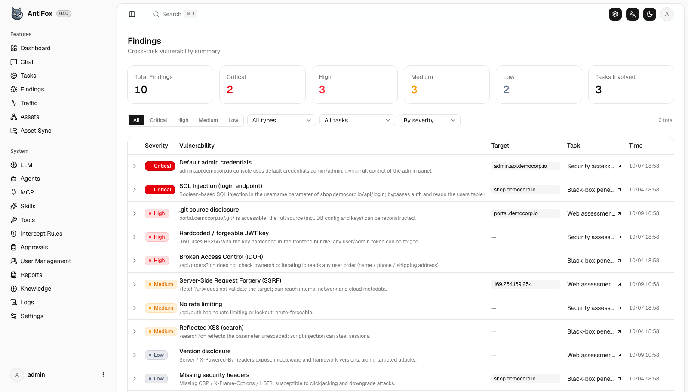
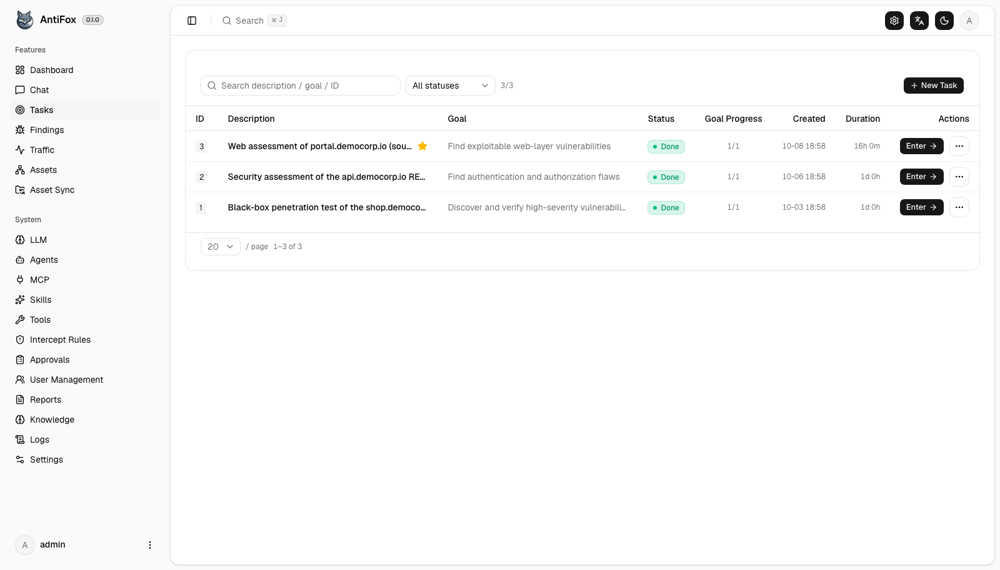
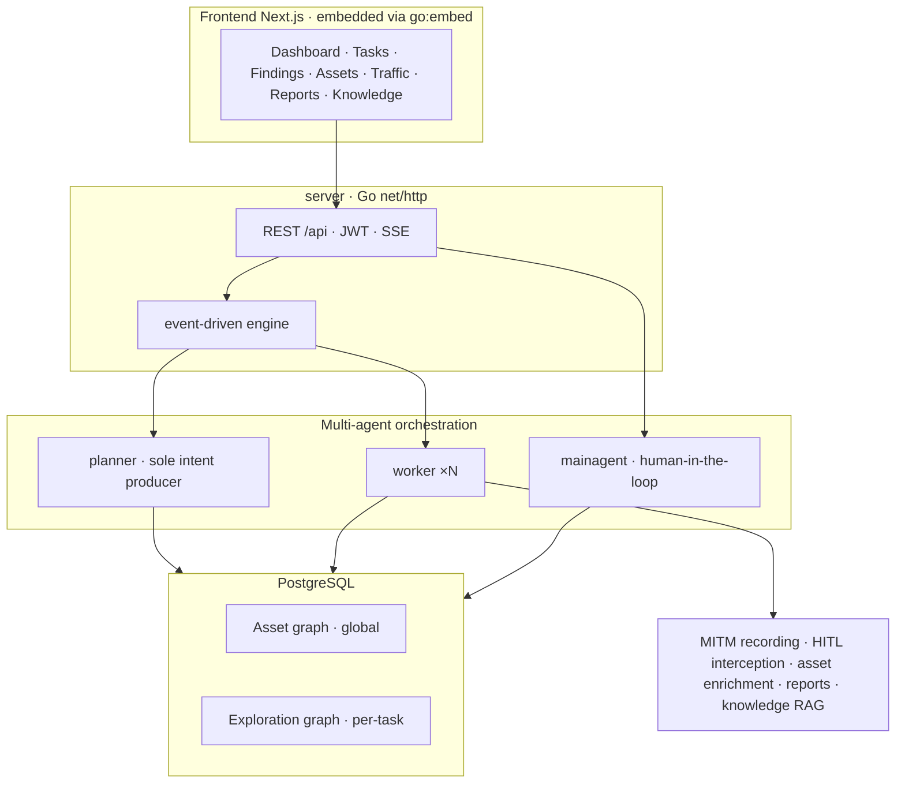

<div align="center">

# AntiFox

**AI-Driven Autonomous Penetration Testing Platform**

[中文](README.md) | English



</div>

---

## Overview

AntiFox is an AI-driven autonomous penetration testing platform. Given an authorized target, a planner / worker / main-agent multi-agent system runs the full engagement over a **dual-graph** core (a global asset graph + a per-task exploration graph) — **recon → attack-surface discovery → exploitation → finding capture → report delivery** — fully observable, interactive, and deliverable.

## Quick Start

Requires **PostgreSQL**; exploration needs an **LLM** (`ANTHROPIC_API_KEY` or `OPENAI_API_KEY`, or configure it in the UI). Generating `.docx` reports needs `python3` + `python-docx` (bundled in the Docker image).

### Option 1: One-command Docker deploy (recommended)

```bash
curl -O https://raw.githubusercontent.com/AntiFox-AI/antifox/main/docker-compose.yml
curl -O https://raw.githubusercontent.com/AntiFox-AI/antifox/main/.env.example
cp .env.example .env          # set POSTGRES_PASSWORD
docker compose up -d          # pulls the image + PostgreSQL and starts
```

Open **http://localhost:8787** — on first run, go to `/setup` to set the admin password.

### Option 2: Prebuilt binary

Download the zip for your platform from [Releases](https://github.com/AntiFox-AI/antifox/releases/latest) (Linux amd64/arm64 · macOS amd64/arm64 · Windows amd64), then:

```bash
cp config.example.json config.json    # fill in the database connection
./antifox                             # antifox.exe on Windows
```

Open **http://localhost:8787**.

### Option 3: Build from source

The **full source is open** (AGPL-3.0). Requires Go 1.24+ / Node 20+ / PostgreSQL / Python 3 (report rendering):

```bash
cd web && NEXT_EXPORT=1 npx next build && cd ..    # frontend static export
cp -r web/out/. server/webui/dist/                 # embed the frontend
CGO_ENABLED=0 go build -tags embedui -o antifox ./cmd/antifox
./antifox
```

Full steps (skill embedding, dev hot-reload) are in [CONTRIBUTING.md](CONTRIBUTING.md).

## Screenshots

| Dashboard | Findings |
| :---: | :---: |
|  |  |

| Tasks |
| :---: |
|  |

> All UI data shown is synthetic demo data.

## Lineage

AntiFox is a fork that started from **v0.1.1** of the open-source project ARTEX (by [@Autumn-27](https://github.com/Autumn-27)), tracking upstream ever since, with mutual exchange along the way. Full credit to the original author's foundational work.

## What AntiFox Adds (vs ARTEX)

Building on its solid foundation (exploration-graph engine, MITM traffic recording, rule-based HITL interception, multi-agent orchestration), AntiFox mainly adds:

| Area | Details |
| --- | --- |
| Trilingual i18n | Full UI in Simplified Chinese / Traditional Chinese / English |
| Multi-user RBAC | Visual permission-matrix custom roles, system roles, resource-level scope, login audit |
| Human-grade reports | AI narrative + python-docx into delivery-grade .docx (cover / TOC / page numbers / per-vuln tables), full report in zh / zh-TW / en |
| Report management | Org settings, named templates (issuer / logo / personnel / CVSS), per-task generation, select which findings to include |
| Deeper vuln management | AI enrichment into structured data (CVSS / impact / fix / structured reproduction), 4 severity levels, batch enrichment, session finding capture |
| Knowledge-base RAG | Global + per-task two-tier pgvector retrieval augmentation for agents |

## Architecture

A single Go backend (Next.js frontend embedded via `go:embed`) + PostgreSQL. The core is a **dual-graph** design: a globally shared asset graph (cross-task source of truth) and a per-task exploration graph (goal / intent / fact / finding lineage), linked by anchors. The engine is event-driven — any graph change wakes the planner to dispatch intents, workers execute and write back, which triggers the next round, until the goal is proven.



## Core Capabilities

- Dual-graph: global asset graph + per-task exploration graph, linked by anchors
- Multi-agent orchestration: event-driven engine, planner produces intents / N workers execute / mainagent is the human interface
- MITM traffic recording, rule-based HITL interception, MCP / Skill extension system

## Credits

- ARTEX (by [@Autumn-27](https://github.com/Autumn-27)) — the technical foundation of this project.

## License & Disclaimer

Licensed under **AGPL-3.0** — see [LICENSE](LICENSE). Use, modification, and redistribution (including offering it as a networked service) must comply with its terms.

**AntiFox is for personal study, code research, and local technical validation only. It must not be used to perform actual testing against any online system or website.**

### Permitted use
- Reading, studying, and researching this project, and verifying technical principles in a local, isolated environment;
- Personal learning, academic research, and other non-offensive purposes.

### Prohibited
- Using this tool to scan, probe, exploit, or attack any website, online service, or networked system;
- Using this tool for any real penetration testing, red/blue exercises, or production environment;
- Using it for intrusion, data theft, ransom, denial of service, or any destructive or criminal activity;
- Using it for anything violating the laws and regulations of your country / region.

### Compliance
Users must comply with all applicable laws and regulations on cybersecurity, data protection, and computer crime in their country / region. All legal responsibility and consequences arising from use of this project rest solely with the user.

### Disclaimer
This project is provided "AS IS", without warranty of any kind. The authors and contributors are not liable for any direct or indirect loss, data loss, system damage, or legal dispute arising from use of this tool. By downloading, installing, or using this project, you acknowledge that you have read, understood, and agree to all of the above.
