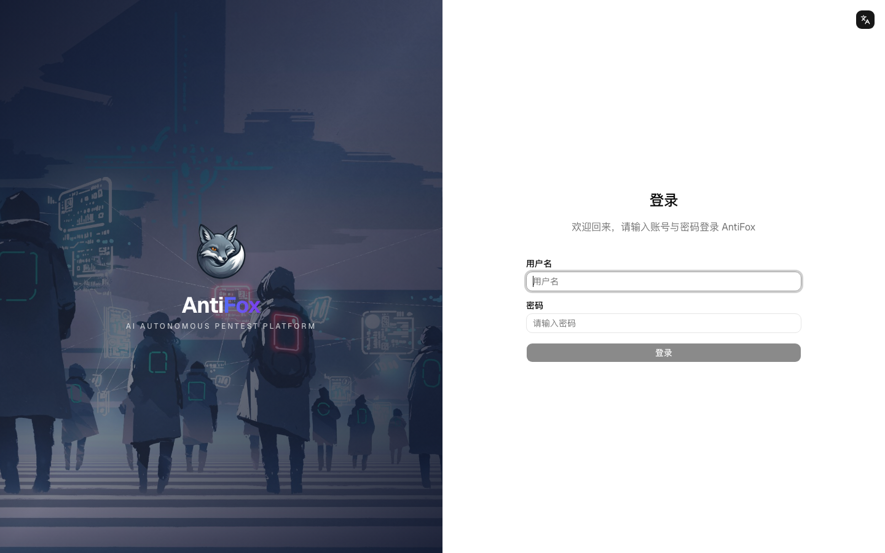
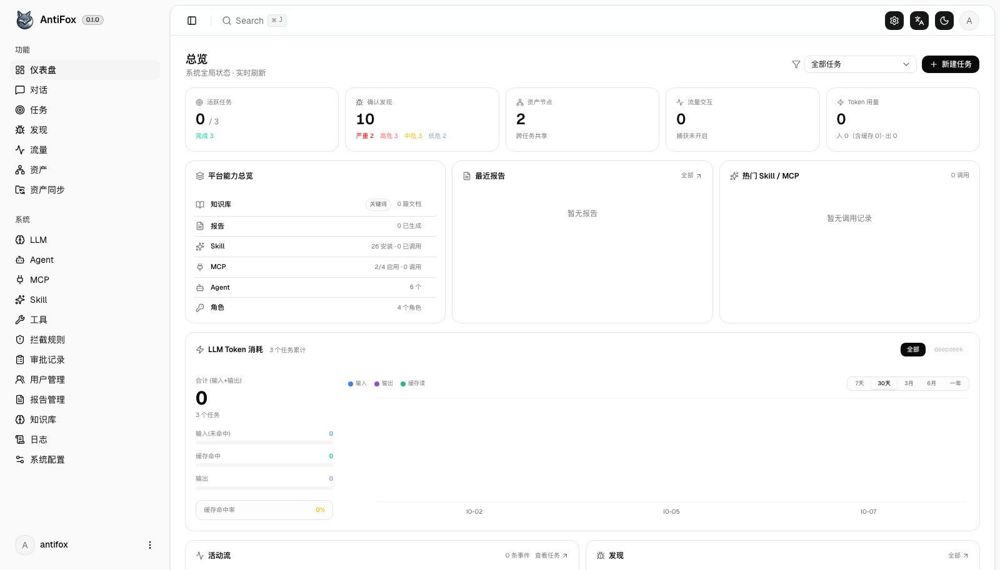
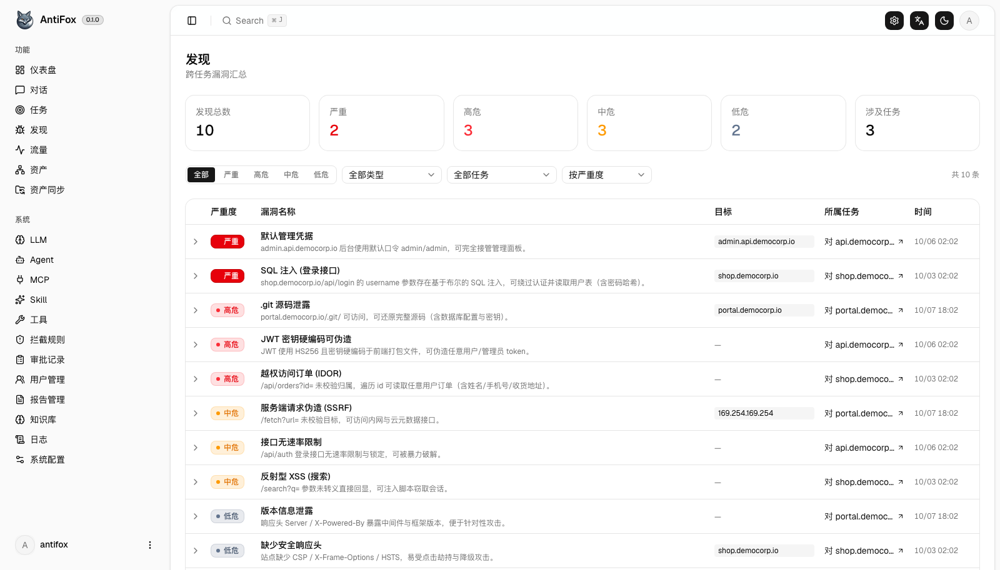
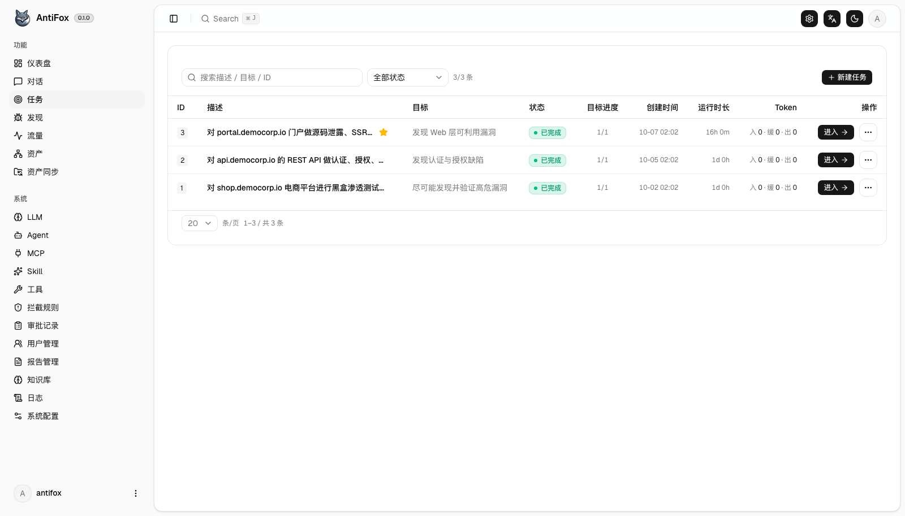
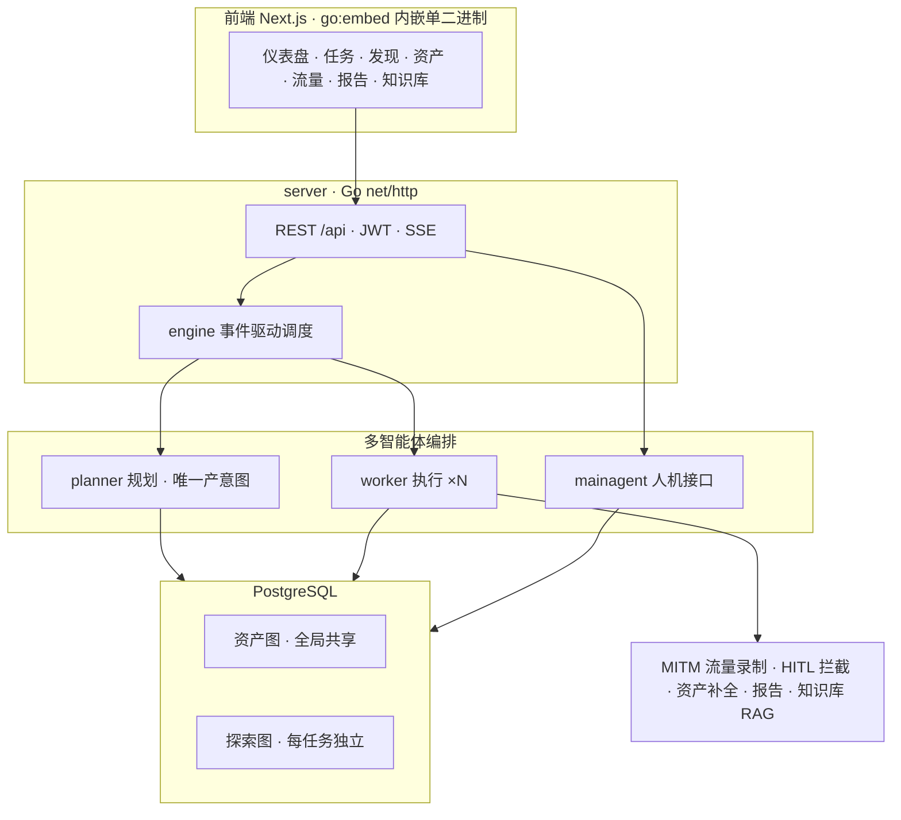

<div align="center">

# AntiFox

**AI 自主渗透测试平台**

中文 | [English](README.en.md)



</div>

---

## 简介

AntiFox 是一套 AI 自主渗透测试平台：给定授权目标，由规划器 / 工作者 / 主控多智能体围绕**双图架构**（全局资产图 + 每任务探索图）自主完成 侦察 → 攻击面发现 → 利用验证 → 漏洞记录 → 报告交付，全程可视化、可介入、可交付。

## 快速开始

依赖 **PostgreSQL**；探索需配置 **LLM**（`ANTHROPIC_API_KEY` 或 `OPENAI_API_KEY`，也可在 UI 的「LLM 配置」页填）。生成 `.docx` 报告需 `python3` + `python-docx`（Docker 镜像已内置）。

### 方式一：Docker 一键部署（推荐）

```bash
curl -O https://raw.githubusercontent.com/AntiFox-AI/antifox/main/docker-compose.yml
curl -O https://raw.githubusercontent.com/AntiFox-AI/antifox/main/.env.example
cp .env.example .env          # 设 POSTGRES_PASSWORD
docker compose up -d          # 自动拉镜像 + PostgreSQL 并启动
```

打开 **http://localhost:8787**，首次进入 `/setup` 设置管理员密码。

### 方式二：下载预编译二进制

到 [Releases](https://github.com/AntiFox-AI/antifox/releases/latest) 下载对应平台 zip（Linux amd64/arm64 · macOS amd64/arm64 · Windows amd64），解压后：

```bash
cp config.example.json config.json    # 填好 database 连接
./antifox                             # Windows 为 antifox.exe
```

打开 **http://localhost:8787**。

### 方式三：从源码构建

本项目**完整源码开放**（AGPL-3.0）。前置 Go 1.24+ / Node 20+ / PostgreSQL / Python 3（报告渲染）：

```bash
cd web && NEXT_EXPORT=1 npx next build && cd ..    # 前端静态导出
cp -r web/out/. server/webui/dist/                 # 内嵌前端
CGO_ENABLED=0 go build -tags embedui -o antifox ./cmd/antifox
./antifox
```

完整步骤（含 skill 内嵌、开发热更新）见 [CONTRIBUTING.md](CONTRIBUTING.md)。

## 截图

| 仪表盘 | 发现 |
| :---: | :---: |
|  |  |

| 任务列表 |
| :---: |
|  |

> 界面数据均为合成演示数据。

## 源起

AntiFox 自开源项目 ARTEX（作者 [@Autumn-27](https://github.com/Autumn-27)）的 **v0.1.1 起二次开发**，此后持续跟进上游演进，期间与上游相互交流借鉴。在此坦诚致谢原作者的奠基性工作。

## 相对 ARTEX 的改进

在继承其优秀底座（探索图引擎、MITM 流量录制、规则化 HITL 拦截、多智能体编排）的基础上，AntiFox 主要增强：

| 方面 | 说明 |
| --- | --- |
| 三语国际化 | 全站简体 / 繁体 / 英文 |
| 多用户权限（RBAC） | 可视化权限矩阵自定义角色、系统角色、资源级范围、登录审计 |
| 人工级报告 | AI 叙述 + python-docx 排版成交付级 .docx（封面 / 目录 / 页码 / 每漏洞属性表），支持中 / 繁 / 英整份 |
| 报告管理 | 组织级设置、命名模版（出具方 / logo / 人员 / CVSS）、按任务生成、勾选收录漏洞子集 |
| 漏洞管理深化 | AI 富化成结构化数据（CVSS / 影响 / 修复 / 结构化复现）、四级严重度、批量富化、会话漏洞补录 |
| 知识库检索增强 | 全局 + 任务双层 pgvector RAG，为 Agent 提供领域知识 |

## 技术架构

Go 单体后端（`go:embed` 内嵌 Next.js 前端）+ PostgreSQL。核心是**双图架构**：全局共享的资产图（跨任务的资产真值库）与每任务独立的探索图（目标 / 意图 / 事实 / 漏洞的推进血缘链），两图靠锚点互连。引擎事件驱动——图一变就唤醒规划器派意图，工作者领意图执行并把结果写回，写回再触发下一轮，直到目标被证明。



## 核心能力

- 双图架构：全局共享资产图 + 每任务独立探索图，靠锚点互连
- 多智能体编排：事件驱动引擎，planner 产意图 / N 个 worker 执行 / mainagent 人机接口
- MITM 流量录制、规则化 HITL 拦截、MCP / Skill 扩展体系

## 致谢

- ARTEX（作者 [@Autumn-27](https://github.com/Autumn-27)）—— 本项目的技术基座。

## 许可与免责声明

本项目基于 **AGPL-3.0** 协议开源，详见 [LICENSE](LICENSE)。使用、修改与再分发（含以网络服务形式提供）须遵守该协议条款。

**AntiFox 仅供个人学习、代码研究与本地技术验证使用，不得用于对任何线上系统或网站发起实际测试。**

### 允许使用范围
- 仅可用于阅读、学习与研究本项目，以及在本地隔离环境中进行技术原理验证；
- 适用于个人学习、学术研究等非攻击性用途。

### 禁止事项
- 严禁使用本工具对任何网站、线上服务或联网系统发起扫描、探测、利用或攻击；
- 严禁将本工具用于任何实际的渗透测试、攻防对抗或生产环境；
- 严禁用于非法入侵、数据窃取、勒索、拒绝服务或任何破坏性、犯罪性活动；
- 严禁利用本工具从事违反所在国家 / 地区法律法规的行为。

### 合规责任
使用者须自行遵守所在国家 / 地区关于网络安全、数据保护与计算机犯罪的全部法律法规。因使用本项目产生的一切法律责任与后果，均由使用者自行承担。

### 免责声明
本项目按“现状（AS IS）”提供，不附带任何明示或默示的担保。作者及贡献者不对使用本工具所导致的任何直接或间接损失、数据丢失、系统损坏或法律纠纷承担责任。下载、安装或使用本项目，即表示你已阅读、理解并同意上述全部条款。
