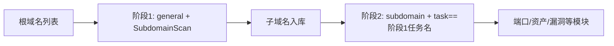

---

## name: scopesentry-mcp
description: Manage a security scanning platform (projects, tasks, templates, assets, nodes) via the ScopeSentry MCP. Use when the user mentions ScopeSentry, MCP, API Key, scan tasks, or asset queries.

# ScopeSentry MCP Usage Guide

For users with a **deployed ScopeSentry instance**. Connect to the platform through Cursor (or another MCP client) — no local source code required.

## 1. Preparation

### 1.1 Confirm the service is reachable

- Default web interface: `http://<host>`
- MCP endpoint: `http://<host>/mcp` (if there is a reverse proxy or front-end proxy in front, use the actual `/mcp` address)

### 1.2 Create an API Key

1. Log in to the ScopeSentry web interface in a browser
2. Go to the **API Key** management page to create a key (or create one through the interface provided by your administrator)
3. Save the returned `ssk_...` string (**shown only once**)

### 1.3 Configure Cursor MCP

Cursor → Settings → MCP → add a server:

```json
{
  "mcpServers": {
    "scopesentry": {
      "url": "http://<你的主机>:8082/mcp",
      "headers": {
        "X-API-Key": "ssk_你的密钥"
      }
    }
  }
}
```

You can also use: `Authorization: Bearer ssk_你的密钥`

After configuring, restart MCP or reload Cursor and confirm that tools such as `list_projects` and `list_assets` appear in the tool list.

---

## 2. Tool Overview


| Tool                    | Purpose                                        |
| ---------------------- | --------------------------------------------- |
| `list_projects`        | Project tree grouped by tag (includes project IDs) |
| `list_projects_data`   | Paginated project list, searchable by name    |
| `get_project`          | Project details                               |
| `create_project`       | Create a project                              |
| `list_tasks`           | List of scan tasks                            |
| `get_task`             | Task details                                  |
| `list_scan_templates`  | List of scan templates                        |
| `get_scan_template`    | Template details                              |
| `list_plugin_modules`  | Scan pipeline module names                    |
| `list_plugins`         | Available plugins (with hash and default parameters) |
| `create_scan_template` | Create a scan template                        |
| `create_scan_task`     | Create a scan task                            |
| `list_assets`          | Query assets of any type (paginated list)     |
| `count_assets`         | Count assets (`/api/assets/common/total`)     |
| `get_asset_detail`     | Asset or vulnerability details                |
| `add_asset_tag`        | Add a tag to an asset                         |
| `list_nodes`           | List of scan nodes                            |


Tool parameters follow the MCP tool descriptions (schemas); `list_assets` / `count_assets` share the same search and filter syntax, so read the `list_assets` description before querying assets.

When you need to know "how many records in total", use `count_assets` (corresponding to the web pagination total endpoint); there is no need to page through `list_assets` repeatedly just to count totals.

---

## 3. Common Workflows

### 3.1 Query assets by project

When the user or context **already has a project condition**, prefer including `filter.project` to narrow the scope and avoid slow responses caused by pulling data across too many projects. If there is no specific project, do not force a project filter.

1. Use `list_projects` or `list_projects_data` to get the target project's **ObjectID** (`id` / `children[].value`)
2. Call `list_assets` with `filter.project` (**must be the ID, not the project's display name**)

```json
{
  "asset_type": "asset",
  "pageIndex": 1,
  "pageSize": 20,
  "search": "domain=^example.com",
  "filter": {
    "project": ["<项目ObjectID>"]
  }
}
```

### 3.2 Create a scan task

1. `list_nodes` to get the names of online nodes
2. `list_scan_templates` or `create_scan_template` to get the template's **ObjectID**
3. `create_scan_task`: `name` and `node` are required; `template` takes the template ID (not the template name)

**Target sources `targetSource` (same as the web UI):**

| targetSource | Description | Required parameters |
| --- | --- | --- |
| `general` | Enter targets directly | `target` |
| `project` | Read targets from a project | `project` (array of project ObjectIDs) |
| `asset` | Search from the web asset library | `search`; optional `project`, `filter`, `targetNumber` |
| `RootDomain` | Search from the root domain library | `search`; optional `project`, `filter`, `targetNumber` |
| `subdomain` | Search from the subdomain library | `search`; optional `project`, `filter`, `targetNumber` |
| `UrlScan` | Search from URL scan results | `search`; optional `project`, `filter`, `targetNumber` |
| `*Source` (e.g. `subdomainSource`) | Created from "selected/searched" items on an asset page | with `targetTp=search` use `search`; with `targetTp=select` use `targetIds` |

**Example — scan root domains directly:**

```json
{
  "name": "example-子域名收集",
  "node": ["node-1"],
  "template": "<模板ObjectID>",
  "targetSource": "general",
  "target": "example.com\nfoo.com",
  "project": ["<项目ObjectID>"]
}
```

**Example — continue scanning from the subdomain library (filtered by the previous task name):**

```json
{
  "name": "example-端口与漏洞",
  "node": ["node-1"],
  "template": "<后续模块模板ObjectID>",
  "targetSource": "subdomain",
  "search": "task==\"example-子域名收集\"",
  "project": ["<项目ObjectID>"]
}
```

### 3.3 Full information gathering for root domains (two-phase approach recommended)

When the input is a **root domain** and you want to perform **full information gathering**, split the work into two scans instead of running the entire pipeline at once.

**Reason:** distributed tasks are dispatched per **individual target**. When a root domain is the target, whichever node receives it will also run the subsequent modules on that same node for all subdomains discovered there, which easily causes uneven load, slow speeds, and errors.

**Best practice:**

1. **Phase 1 — subdomain collection only**
   - `targetSource`: `general`
   - `target`: all root domains (multiple lines)
   - Template: enable only `SubdomainScan` and `SubdomainSecurity` (subdomain scanning + subdomain takeover)
   - Use `get_task` to wait for the task to finish

2. **Phase 2 — subsequent modules**
   - `targetSource`: `subdomain`
   - `search`: `task=="<Phase-1 task name>"` (exact match on the task name)
   - Optionally `project` to narrow the scope
   - Template: port scanning, asset mapping, vulnerability scanning, etc. (SubdomainScan can be omitted)
   - Subdomains are dispatched as independent targets across nodes, giving much better parallel efficiency

Alternatively, in the web interface's "Subdomain" asset page, filter by task name and use "Create task from subdomains" — the result is the same.



### 3.4 Create a scan template

1. `list_plugin_modules` → list of module names
2. `list_plugins` (optionally filtered by `module`) → each plugin's `hash` and default `parameter`
3. `create_scan_template`: use `modules` to specify "module → array of plugin hashes"

---

## 4. Asset Queries (`list_assets` / `count_assets`)

`count_assets` uses the same `asset_type`, `search`, and `filter` as `list_assets` and returns `{ "total": N }`, corresponding to the web endpoint `/api/assets/common/total`.

```json
{
  "asset_type": "subdomain",
  "search": "task==\"某任务名\"",
  "filter": {"project": ["<项目ObjectID>"]}
}
```

**Performance tips (common to `list_assets` / `count_assets`):** when you have a project condition, prefer `filter.project` to narrow the scope; in `search`, prefer `==` exact match or `^` prefix match on indexed fields (see [4.3](#43-search-search-expressions)) and avoid broad `=` fuzzy queries that slow down responses. Without project context, do not force a project filter.

Types supporting `filter.project` are listed in the table in [4.4](#44-filter-exact-filtering).

### 4.1 Asset types `asset_type`

`asset`, `RootDomain`, `subdomain`, `app`, `mp`, `UrlScan`, `SensitiveResult`, `DirScanResult`, `crawler`, `vulnerability`, `PageMonitoring`, `IPAsset`, `SubdomainTakerResult`

Alias examples: `web`→asset, `vuln`→vulnerability, `ip`→IPAsset, `url`→UrlScan

### 4.2 Parameter Reference


| Parameter                  | Description                                        |
| ------------------------ | ------------------------------------------------- |
| `pageIndex` / `pageSize` | Pagination, defaults 1 / 20                       |
| `search`                 | Search expression (see next section)              |
| `filter`                 | Exact-filter JSON (see next section)              |
| `sort`                   | Only UrlScan and DirScanResult support sorting by `length` |
| `sid`                    | Only SensitiveResult: sensitive rule name         |


`search` and `filter` **can be used together**.

### 4.3 search search-expressions

A custom DSL (**not SQL**):


| Operator | Meaning                | Index        | Example                          |
| ---- | ---- | ---- | --------------------------- |
| `=`  | Fuzzy match (regex)    | No index     | `domain=example`            |
| `==` | Exact match (equality) | **Uses index** | `port==443`                 |
| `!=` | Exclude                | — | `port!="80"`                |
| `&&` | AND                    | — | `domain==example.com && port==443` |
| `||` | OR                     | — | `title=admin \|\| body=login` |


**Indexes and operators:** fields such as `domain`, `ip`, `port`, and `title` are indexed, but only **`==` exact match** or a **prefix match where the value starts with `^`** (e.g. `domain=^example.com`) can use the index; **`=` becomes a regex fuzzy match and cannot use the index**, which tends to get slow at scale.

**search fields common to all types:** `tag`, `task` (task name), `rootDomain`

**project cannot be written inside search** (it is either ignored or errors when combined with `&&`). To filter by project, use `filter.project`.

**Commonly used search fields per type:**


| asset_type           | Fields                                                                              |
| -------------------- | ----------------------------------------------------------------------------------- |
| asset                | domain, ip, port, service, app, title, statuscode, icon, banner, type, body, header |
| RootDomain           | domain, icp, company                                                                |
| subdomain            | domain, ip, type, value                                                             |
| app                  | name, icp, company, category, description, url, apk                                 |
| mp                   | name, icp, company, category, description, url                                      |
| UrlScan              | url, input, source, resultId, type                                                  |
| SensitiveResult      | url, sname, body, info, md5                                                         |
| DirScanResult        | url, statuscode, redirect, length                                                   |
| vulnerability        | url, vulname, matched, request, response, level                                     |
| crawler              | url, method, body, resultId                                                         |
| PageMonitoring       | url, hash, diff, response                                                           |
| IPAsset              | ip, domain, port, service, webServer, app                                           |
| SubdomainTakerResult | domain, value, type, response                                                       |


**search examples:**

- `domain==www.example.com && port==443` (exact match, uses index)
- `domain=^example.com` (prefix match, uses index)
- `ip==192.168.1.1`
- `task=="某任务名"`
- `level==high` (vulnerability)
- `statuscode==200` (DirScanResult)

Use `=` only when you need fuzzy containment, e.g. `title=admin` (no index; best combined with narrowing conditions such as project).

### 4.4 filter exact-filtering

A JSON object: multiple values for the same key mean **OR**, different keys mean **AND**.

**Prefer `project` when you have a project condition:** if the user or context already specifies a project and the asset_type supports `project`, include it to narrow the scope; without project information, it is not required.


| filter key   | Meaning      | Value notes                                                |
| ------------ | -------- | -------------------------------------------------------- |
| `project`    | Owning project | **ObjectID**, obtained via `list_projects` / `list_projects_data` |
| `task`       | Source task | **Task name**, the `name` from `list_tasks`              |
| `port`       | Port       | e.g. `"443"`                                             |
| `service`    | Service/protocol | e.g. `"https"`                                       |
| `app`        | Application fingerprint | e.g. `"Nginx"`                                  |
| `icon`       | Icon hash  |                                                          |
| `statuscode` | HTTP status code | Mainly for asset                                    |
| `status`     | Status     | UrlScan/DirScan HTTP code; vulnerability/sensitive-info handling status |
| `level`      | Vulnerability severity | critical / high / medium / low / info          |
| `type`       | Type       | e.g. subdomain record type A, CNAME                      |
| `color`      | Sensitive rule color | SensitiveResult                                    |
| `sname`      | Sensitive rule name | SensitiveResult                                    |
| `tags`       | Tags       |                                                          |


**Available filter keys per type:**


| asset_type                            | filter key                                                      |
| ------------------------------------- | --------------------------------------------------------------- |
| asset                                 | project, port, service, app, icon, statuscode, type, task, tags |
| RootDomain                            | project, tags                                                   |
| subdomain                             | project, type, task, tags                                       |
| app / mp                              | project, tags                                                   |
| UrlScan                               | status, tags                                                    |
| DirScanResult                         | status, tags                                                    |
| SensitiveResult                       | status, color, sname, tags                                      |
| crawler                               | project, task, tags                                             |
| vulnerability                         | project, level, status, task, tags                              |
| PageMonitoring / SubdomainTakerResult | tags                                                            |
| IPAsset                               | project, port, service, app                                     |


**filter example:**

```json
{"project": ["<项目ObjectID>"], "port": ["443"]}
```

**Combined query example:**

```json
{
  "asset_type": "asset",
  "search": "domain=^baidu && port==443",
  "filter": {"project": ["<项目ObjectID>"]},
  "pageIndex": 1,
  "pageSize": 10
}
```

**Notes:**

- Prefer `filter.project` (when supported) if you have a project condition; without project context it is optional
- Do not put the project's display name in `filter.project`
- Use `==` for known values and `^` for prefixes; avoid heavy use of `=` fuzzy matching on large tables
- For UrlScan HTTP status use `filter.status`; for DirScanResult you can use `statuscode==200` in search
- For SensitiveResult by rule name: use `sname=<rule name>` in `search`, or `filter.sname`

### 4.5 Sorting sort

Only **UrlScan** and **DirScanResult** support it:

```json
{"length": "ascending"}
```

Other types ignore `sort` and use the default time ordering.

---

## 5. Scan Template Module Names

`TargetHandler`, `SubdomainScan`, `SubdomainSecurity`, `PortScanPreparation`, `PortScan`, `PortFingerprint`, `AssetMapping`, `AssetHandle`, `URLScan`, `WebCrawler`, `URLSecurity`, `DirScan`, `VulnerabilityScan`, `PassiveScan`

---

## 6. Troubleshooting


| Symptom       | Resolution                                                 |
| --------- | -------------------------------------------------- |
| MCP has no tools   | Check the URL, API Key, and that ScopeSentry is running   |
| 401 / 403 | Recreate or replace the API Key                    |
| Assets not found     | Confirm `filter.project` is an ObjectID; do not put project in search |
| Template/task creation fails | `template` must be the template ObjectID; `node` must be an online node name |
| Queries slow/stuck   | Add `filter.project` when you have a project; switch indexed fields in search to `==` or `^` prefix instead of `=`; reduce `pageSize` |


---

